# polish/1130 화면 다듬기 비교 (2026-11-23)

목표: 다른 팀 학생이 처음 켰을 때 어색하지 않게. 기능·채점 규칙·배점은 그대로입니다.
'전'은 단계 9 검증 캡처(`docs/검증/파일모드`), '후'는 이 브랜치의 JAR로 같은 도구(`app.tools.UiWalkthrough`)를 돌린 캡처입니다.

| 화면 (요청 번호) | 전 | 후 | 바뀐 점 |
|---|---|---|---|
| 로그인 (10) | 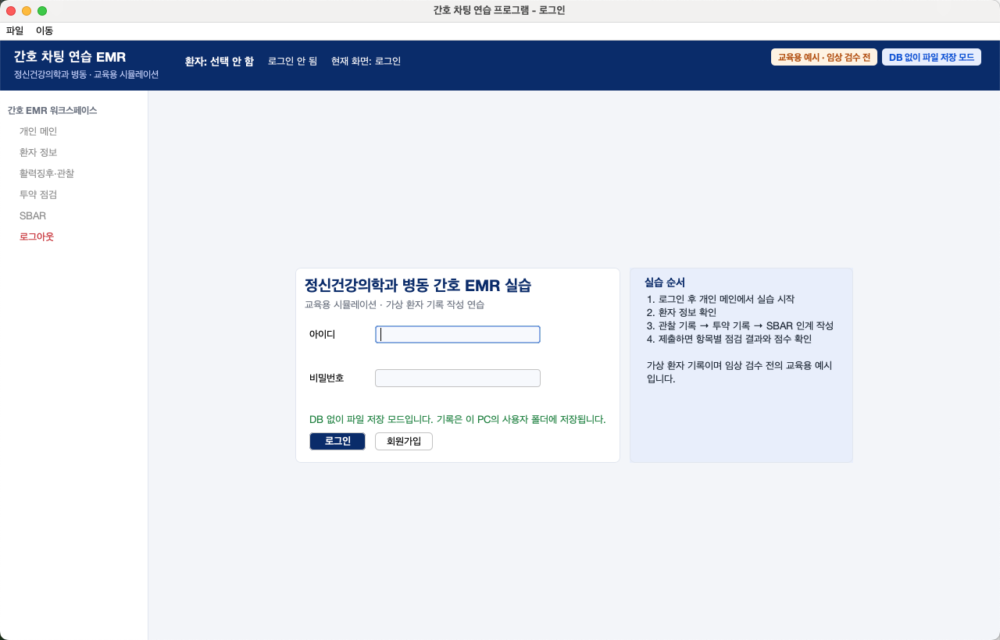 | 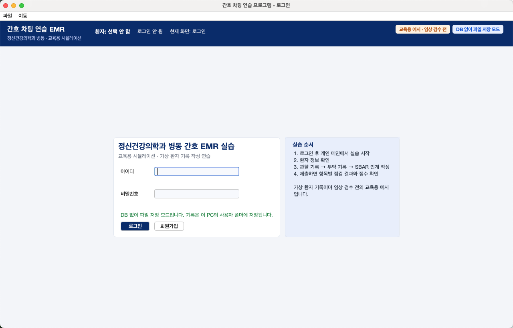 | 로그인 전 왼쪽 메뉴·로그아웃 숨김 |
| 환자 정보 (1·6·9) | 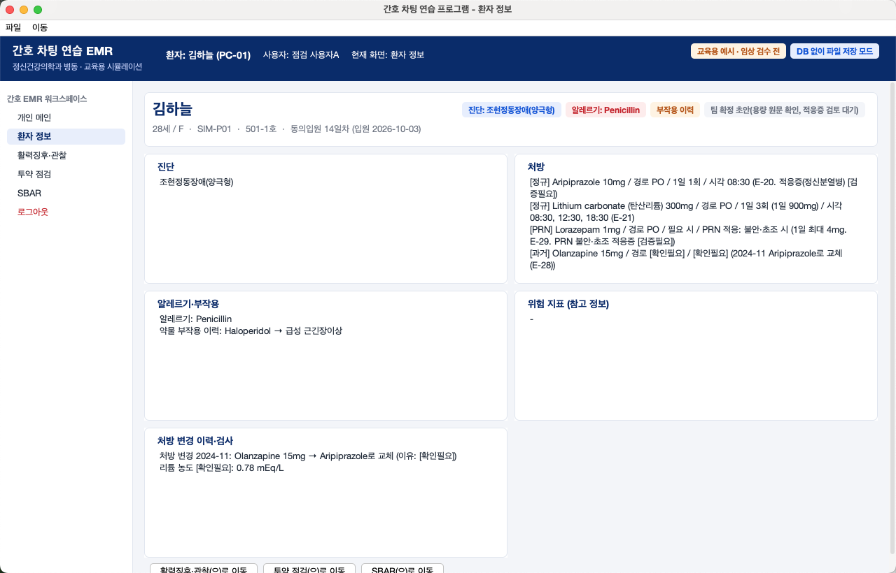 | 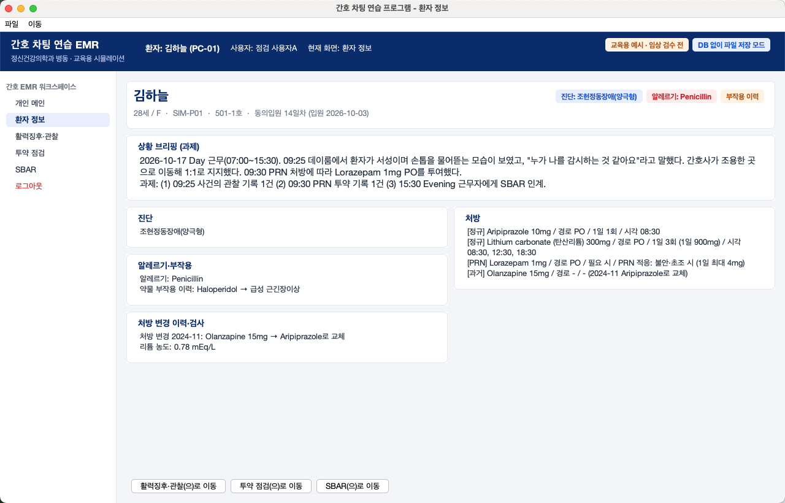 | 근거 번호·[검증필요]·검토 상태 배지 숨김, 상황 브리핑(과제) 카드 추가, 빈 위험 지표 카드 제거, 카드 높이를 내용에 맞춤 |
| 근거·출처 창 (1) | (없던 화면) | 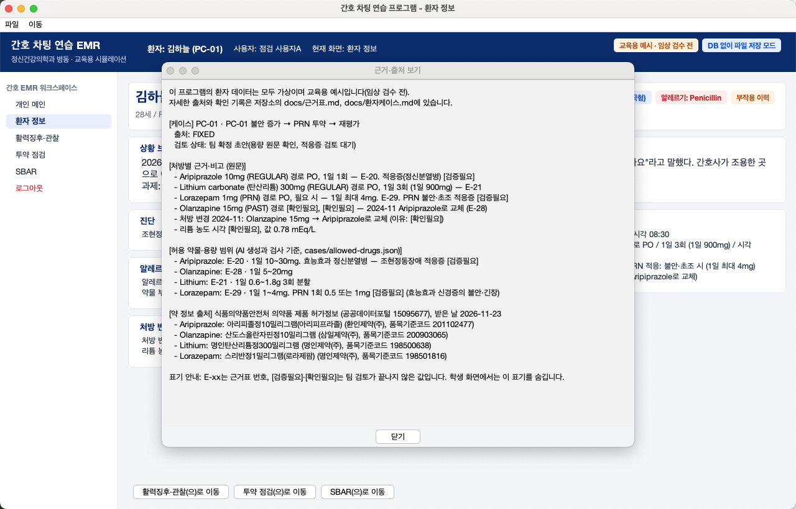 | 파일 → 근거·출처 보기: 숨긴 근거 번호·검토 상태·[확인필요] 원문 |
| 관찰 (5·6·7) | 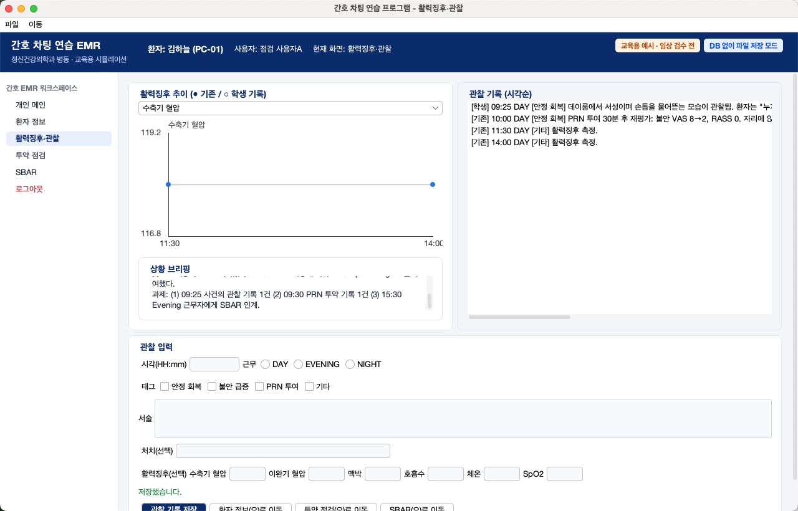 | 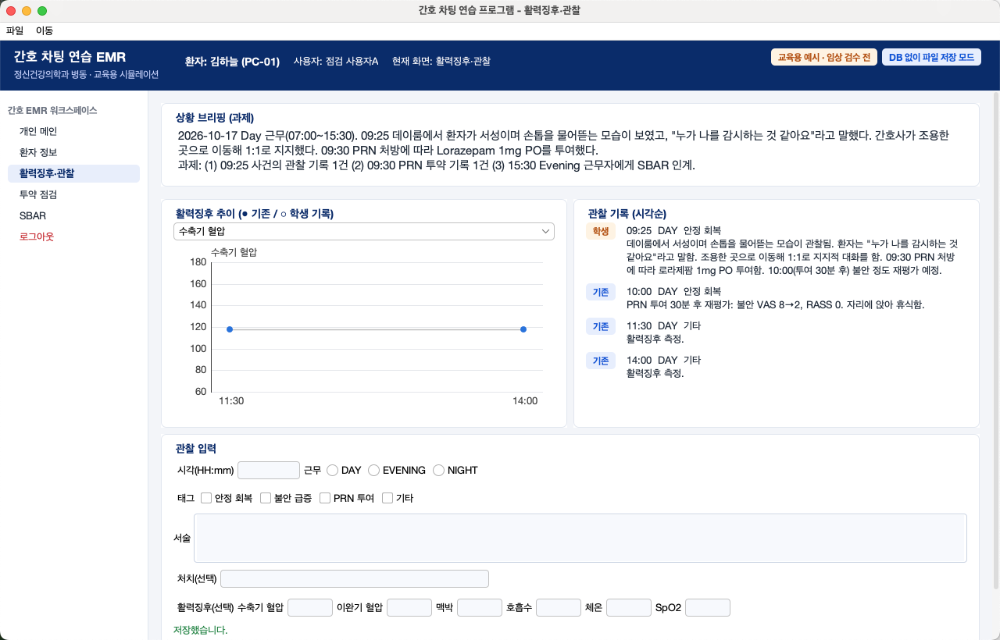 | 브리핑을 맨 위에 큰 글씨로 전체 표시, 관찰 목록 줄바꿈·기존/학생 배지, 차트 세로축 60~180·눈금 |
| 투약 (8) | 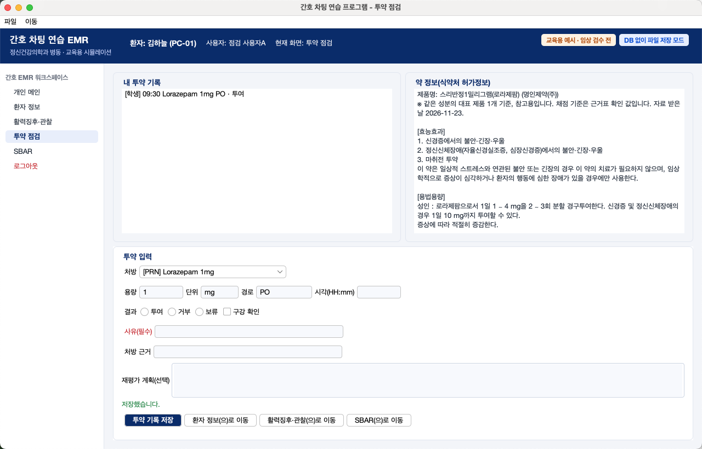 | 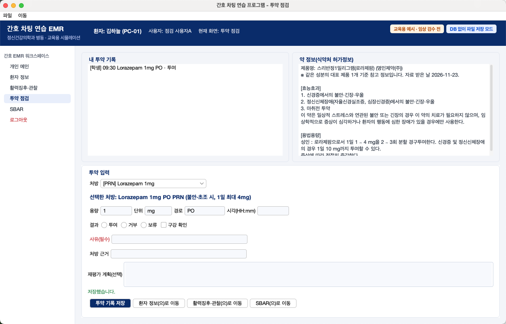 | 처방을 골라도 입력칸 빈칸, '선택한 처방: Lorazepam 1mg PO PRN (…)' 표시 |
| 결과 — 모범 기록 (3) | 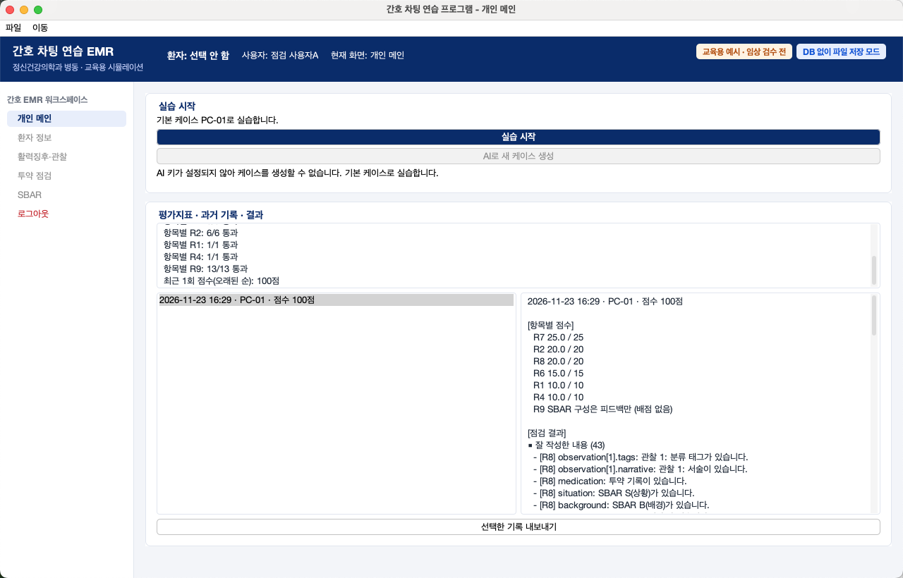 | 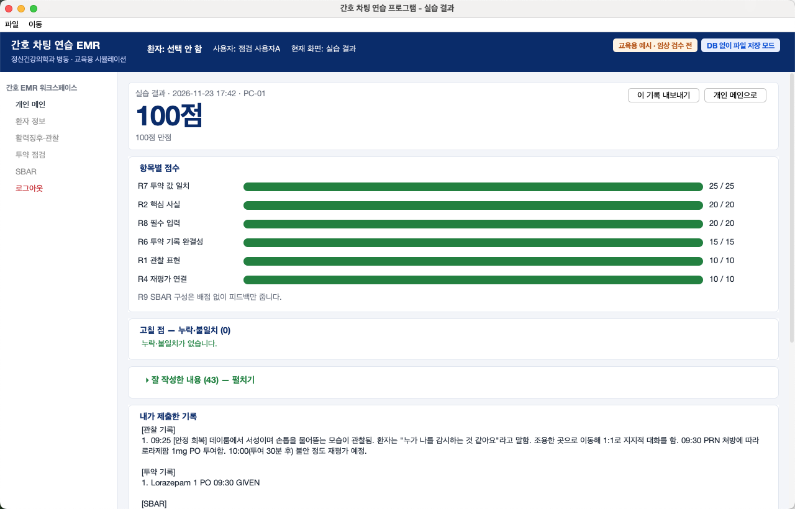 | 제출 직후 결과 화면: 총점 → 항목별 점수 막대 → 고칠 점 → 잘 작성한 내용(접힘) … |
| 결과 — 잘 작성한 내용 펼침 (3) | (없던 화면) | 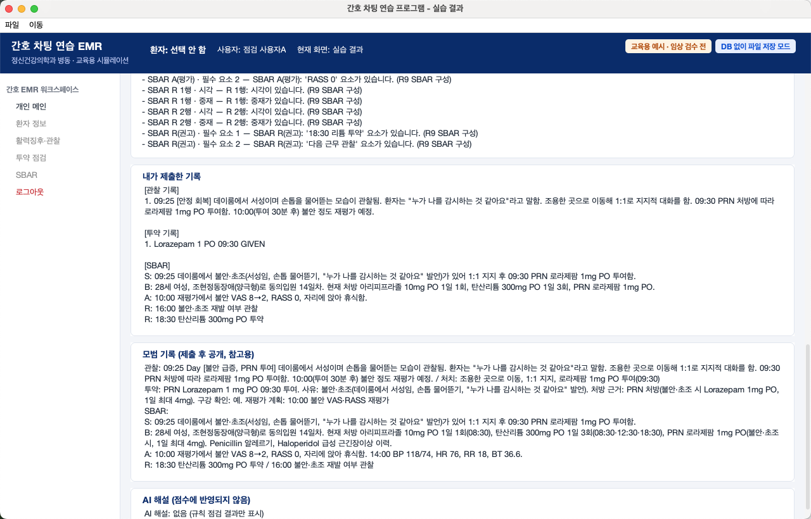 | 펼치기/접기 |
| 결과 — 틀린 기록 (2·3) | 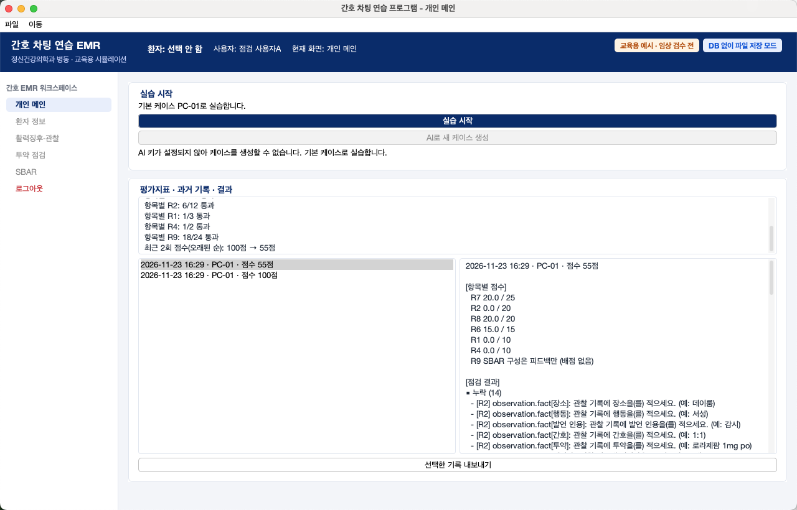 | 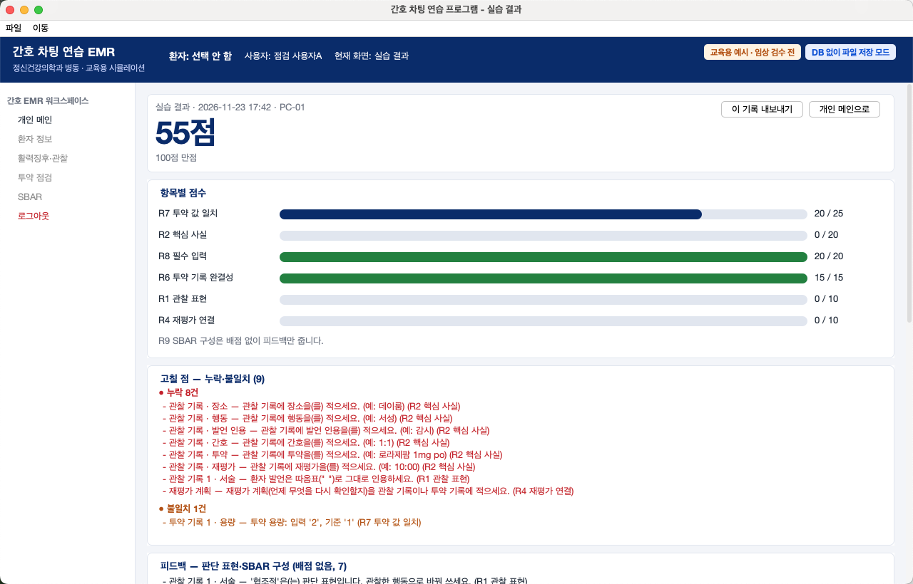 | 누락 빨강·불일치 주황, 위치를 '관찰 기록 · 장소', '투약 기록 1 · 용량'처럼 표시, 규칙은 괄호 |
| 개인 메인 (4) |  | 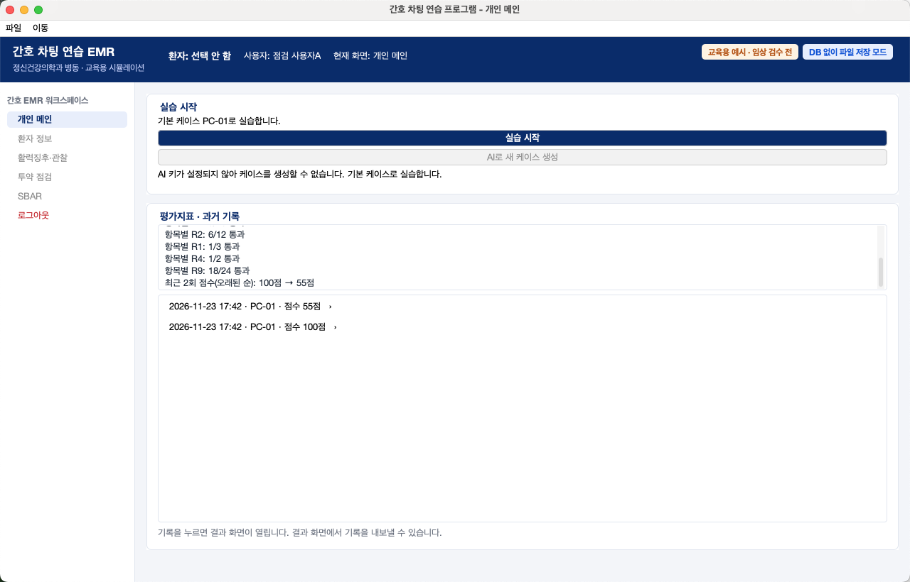 | 과거 기록 목록만, 누르면 결과 화면 |
| 과거 기록 다시 열기 (4) | (없던 화면) |  | 같은 결과 화면 |

## 실제 창 검증 결과 (파일 저장 모드 · AI 키 없음)

| 시나리오 | 기대 | 실제 | 결과 |
|---|---|---|---|
| 로그인 화면 | 로그인 전에는 왼쪽 메뉴(로그아웃 포함) 숨김 | 메뉴 숨김 | 통과 |
| 저장 방식 | DB 설정이 없으면 파일 저장 모드 안내 | 파일 저장 모드 안내 표시 | 통과 |
| S1 | 가입 후 로그인 화면으로 | 간호 차팅 연습 프로그램 - 로그인 | 통과 |
| S1 | 중복 아이디 가입 거부 | 이미 사용 중인 아이디입니다. | 통과 |
| S1 | 틀린 비밀번호·없는 아이디의 문구가 같음 | '아이디 또는 비밀번호가 올바르지 않습니다.' / '아이디 또는 비밀번호가 올바르지 않습니다.' | 통과 |
| S1 | 비밀번호 평문 미저장 | users.json에 평문 없음 | 통과 |
| S1 | 정상 로그인 → 개인 메인 | 간호 차팅 연습 프로그램 - 개인 메인 | 통과 |
| S2 | PC-01 환자 정보 표시, 정답 비공개 | 김하늘 표시, 모범 기록 없음 | 통과 |
| 환자 정보 | 상황 브리핑(과제) 표시, 개발용 표기 숨김 | 브리핑 표시, 개발용 표기 없음 | 통과 |
| 환자 정보 | 비어 있는 위험 지표 카드 숨김 | 카드 없음 | 통과 |
| 근거 창 | 파일 → 근거·출처 보기에서 근거 번호·검토 상태 원문 | E-20·검토 상태 표시 | 통과 |
| S3 | 빈 서술 저장 보류·안내 | 서술을 입력하세요. | 통과 |
| S3 | 정상 관찰 저장, 기존·학생 배지로 구분, 활력징후 추이 | 학생·기존 배지 표시, 추이 차트 있음 | 통과 |
| 관찰 화면 | 상황 브리핑이 화면 위쪽에 전체 표시 | 브리핑 전체 표시 | 통과 |
| 차트 | 수축기 혈압 세로축 60~180, 눈금 | 60~180 | 통과 |
| V6 | 거부 + 사유 누락 저장 보류 | 용량을 입력하세요. 단위를 입력하세요. 경로를 입력하세요. PRN·거부·보류는 사유를 입력해야 합니다. | 통과 |
| 투약 화면 | 처방을 골라도 입력칸 빈칸, '선택한 처방' 표시 | 선택한 처방: Lorazepam 1mg PO PRN (불안·초조 시, 1일 최대 4mg) / 입력칸 빈칸 | 통과 |
| 투약 화면 | 개발용 표기 숨김 | 없음 | 통과 |
| 약 정보 | PRN 로라제팜 선택 시 식약처 허가정보 표시 | 제품명: 스리반정1밀리그램(로라제팜) (명인제약(주)) | 통과 |
| S4 | PRN 사유 누락 저장 보류 | PRN·거부·보류는 사유를 입력해야 합니다. | 통과 |
| S4 | 처방 목록에서만 선택(3개), 사유 채우면 저장 | 저장됨 | 통과 |
| S5·V5 | B 누락 시 제출 보류·안내, S 유지 | B(배경)를 입력하세요. / S 유지 | 통과 |
| V7 | R 행 시각 누락 시 안내 | R 1행: 시각을 입력하세요. (예: 14:30) | 통과 |
| S5 | 제출 성공 → 방금 제출한 실습의 결과 화면 | 간호 차팅 연습 프로그램 - 실습 결과 | 통과 |
| S6 | 모범 기록대로 입력하면 100점·누락/불일치 없음 | 2026-11-23 17:42 · PC-01 · 점수 100점, R7 25.0 | 통과 |
| 결과 화면 | 총점 → 항목별 점수 → 고칠 점 → 피드백 → 잘 작성한 내용(접힘) → 모범 기록 → AI 해설 | 순서 맞음, 잘한 내용 접힘 | 통과 |
| 결과 화면 | 점검 위치를 사람 말로, 개발용 표기 숨김 | 사람 말 위치, 개발용 표기 없음 | 통과 |
| S7 | AI 키 없음 → 해설 없음 안내, 점수 유지 | AI 해설: 없음 안내 | 통과 |
| 내보내기 | UTF-8 파일에 한글이 깨지지 않음 | 한글 정상(데이룸·로라제팜) | 통과 |
| S8 | 개인 메인은 과거 기록 목록만 | 기록 1건 | 통과 |
| S6 | 틀린 기록은 감점·항목별 지적 | 2026-11-23 17:42 · PC-01 · 점수 55점 | 통과 |
| R7 | 투약 자동 채움이 없어 R7이 학생 입력에 따라 달라짐 | 모범 입력 R7 25.0 / 용량 2mg 입력 R7 20.0 | 통과 |
| V1 | 판단 표현 '협조적' 피드백(R1) | - 관찰 기록 1 · 서술 — '협조적'은(는) 판단 표현입니다. 관찰한 행동으로 바꿔 쓰세요. (R1 관찰 표현) | 통과 |
| V2 | 환자 발언 인용 누락 → R1 따옴표 인용 + R2 발언 인용 요소 지적 | - 관찰 기록 1 · 서술 — 환자 발언은 따옴표(" ")로 그대로 인용하세요. (R1 관찰 표현) / - 관찰 기록 · 발언 인용 — 관찰 기록에 발언 인용을(를) 적으세요. (예: 감시) (R2 핵심 사실) | 통과 |
| V3 | 다른 용량 2mg → R7 불일치(입력·기준) | - 투약 기록 1 · 용량 — 투약 용량: 입력 '2', 기준 '1' (R7 투약 값 일치) | 통과 |
| V4 | 재평가 계획 누락 → R4 지적 | - 재평가 계획 — 재평가 계획(언제 무엇을 다시 확인할지)을 관찰 기록이나 투약 기록에 적으세요. (R4 재평가 연결) | 통과 |
| S1 | 로그아웃 후 이전 사용자 상태 제거 | 간호 차팅 연습 프로그램 - 로그인, 케이스 비움 | 통과 |
| S8 | 다른 사용자에게 A의 기록 미표시 | B 기록 0건 | 통과 |
| 결과 화면 | 과거 기록을 누르면 같은 결과 화면 | 간호 차팅 연습 프로그램 - 실습 결과 | 통과 |
| S8 | 재로그인 시 A의 기록·입력·평가지표 복원 | 기록 2건, 총 실습 횟수: 2회 | 통과 |
| S9 | AI 키 없음 → 생성 버튼 꺼짐·이유 표시 | 이유 표시 | 통과 |

## 실제 창 검증 결과 (MySQL · 실제 AI 해설 1회 · AI 케이스 생성 1회)

캡처: [DB_AI/](DB_AI/)

| 시나리오 | 기대 | 실제 | 결과 |
|---|---|---|---|
| 로그인 화면 | 로그인 전에는 왼쪽 메뉴(로그아웃 포함) 숨김 | 메뉴 숨김 | 통과 |
| 저장 방식 | MySQL에 저장(파일 모드 안내 없음) | 파일 모드 안내 없음 | 통과 |
| S1 | 가입 후 로그인 화면으로 | 간호 차팅 연습 프로그램 - 로그인 | 통과 |
| S1 | 중복 아이디 가입 거부 | 이미 사용 중인 아이디입니다. | 통과 |
| S1 | 틀린 비밀번호·없는 아이디의 문구가 같음 | '아이디 또는 비밀번호가 올바르지 않습니다.' / '아이디 또는 비밀번호가 올바르지 않습니다.' | 통과 |
| S1 | 정상 로그인 → 개인 메인 | 간호 차팅 연습 프로그램 - 개인 메인 | 통과 |
| S2 | PC-01 환자 정보 표시, 정답 비공개 | 김하늘 표시, 모범 기록 없음 | 통과 |
| 환자 정보 | 상황 브리핑(과제) 표시, 개발용 표기 숨김 | 브리핑 표시, 개발용 표기 없음 | 통과 |
| 환자 정보 | 비어 있는 위험 지표 카드 숨김 | 카드 없음 | 통과 |
| 근거 창 | 파일 → 근거·출처 보기에서 근거 번호·검토 상태 원문 | E-20·검토 상태 표시 | 통과 |
| S3 | 빈 서술 저장 보류·안내 | 서술을 입력하세요. | 통과 |
| S3 | 정상 관찰 저장, 기존·학생 배지로 구분, 활력징후 추이 | 학생·기존 배지 표시, 추이 차트 있음 | 통과 |
| 관찰 화면 | 상황 브리핑이 화면 위쪽에 전체 표시 | 브리핑 전체 표시 | 통과 |
| 차트 | 수축기 혈압 세로축 60~180, 눈금 | 60~180 | 통과 |
| V6 | 거부 + 사유 누락 저장 보류 | 용량을 입력하세요. 단위를 입력하세요. 경로를 입력하세요. PRN·거부·보류는 사유를 입력해야 합니다. | 통과 |
| 투약 화면 | 처방을 골라도 입력칸 빈칸, '선택한 처방' 표시 | 선택한 처방: Lorazepam 1mg PO PRN (불안·초조 시, 1일 최대 4mg) / 입력칸 빈칸 | 통과 |
| 투약 화면 | 개발용 표기 숨김 | 없음 | 통과 |
| 약 정보 | PRN 로라제팜 선택 시 식약처 허가정보 표시 | 제품명: 스리반정1밀리그램(로라제팜) (명인제약(주)) | 통과 |
| S4 | PRN 사유 누락 저장 보류 | PRN·거부·보류는 사유를 입력해야 합니다. | 통과 |
| S4 | 처방 목록에서만 선택(3개), 사유 채우면 저장 | 저장됨 | 통과 |
| S5·V5 | B 누락 시 제출 보류·안내, S 유지 | B(배경)를 입력하세요. / S 유지 | 통과 |
| V7 | R 행 시각 누락 시 안내 | R 1행: 시각을 입력하세요. (예: 14:30) | 통과 |
| S5 | 제출 성공 → 방금 제출한 실습의 결과 화면 | 간호 차팅 연습 프로그램 - 실습 결과 | 통과 |
| S6 | 모범 기록대로 입력하면 100점·누락/불일치 없음 | 2026-11-23 17:43 · PC-01 · 점수 100점, R7 25.0 | 통과 |
| 결과 화면 | 총점 → 항목별 점수 → 고칠 점 → 피드백 → 잘 작성한 내용(접힘) → 모범 기록 → AI 해설 | 순서 맞음, 잘한 내용 접힘 | 통과 |
| 결과 화면 | 점검 위치를 사람 말로, 개발용 표기 숨김 | 사람 말 위치, 개발용 표기 없음 | 통과 |
| S7 | SBAR 제출 후 AI 해설 표시(점수 불변) | 해설 표시 | 통과 |
| 내보내기 | UTF-8 파일에 한글이 깨지지 않음 | 한글 정상(데이룸·로라제팜) | 통과 |
| S8 | 개인 메인은 과거 기록 목록만 | 기록 1건 | 통과 |
| S6 | 틀린 기록은 감점·항목별 지적 | 2026-11-23 17:43 · PC-01 · 점수 55점 | 통과 |
| R7 | 투약 자동 채움이 없어 R7이 학생 입력에 따라 달라짐 | 모범 입력 R7 25.0 / 용량 2mg 입력 R7 20.0 | 통과 |
| V1 | 판단 표현 '협조적' 피드백(R1) | - 관찰 기록 1 · 서술 — '협조적'은(는) 판단 표현입니다. 관찰한 행동으로 바꿔 쓰세요. (R1 관찰 표현) | 통과 |
| V2 | 환자 발언 인용 누락 → R1 따옴표 인용 + R2 발언 인용 요소 지적 | - 관찰 기록 1 · 서술 — 환자 발언은 따옴표(" ")로 그대로 인용하세요. (R1 관찰 표현) / - 관찰 기록 · 발언 인용 — 관찰 기록에 발언 인용을(를) 적으세요. (예: 감시) (R2 핵심 사실) | 통과 |
| V3 | 다른 용량 2mg → R7 불일치(입력·기준) | - 투약 기록 1 · 용량 — 투약 용량: 입력 '2', 기준 '1' (R7 투약 값 일치) | 통과 |
| V4 | 재평가 계획 누락 → R4 지적 | - 재평가 계획 — 재평가 계획(언제 무엇을 다시 확인할지)을 관찰 기록이나 투약 기록에 적으세요. (R4 재평가 연결) | 통과 |
| S1 | 로그아웃 후 이전 사용자 상태 제거 | 간호 차팅 연습 프로그램 - 로그인, 케이스 비움 | 통과 |
| S8 | 다른 사용자에게 A의 기록 미표시 | B 기록 0건 | 통과 |
| 결과 화면 | 과거 기록을 누르면 같은 결과 화면 | 간호 차팅 연습 프로그램 - 실습 결과 | 통과 |
| S8 | 재로그인 시 A의 기록·입력·평가지표 복원 | 기록 2건, 총 실습 횟수: 2회 | 통과 |
| S9 | AI 생성 케이스로 실습 시작(허용 약물 검사 통과) | GEN-2, AI_GENERATED | 통과 |
| S9 | 상단에 'AI 생성 · 임상 검수 전' 표시 | 교육용 예시 · 임상 검수 전  /  AI 생성 · 임상 검수 전 | 통과 |
| S9 | AI 생성 케이스 기록 저장·채점(R7·R2) | 2026-11-23 17:44 · GEN-2 · 점수 90점, R7 25.0, R2 10.0 | 통과 |
| S9 | AI 환자는 PC-01과 다른 이름·나이·병실, 로그 2건·활력 2회 이상 | 박준영, 35세, 402호, 로그 2건, 활력 2회 | 통과 |

## 확인하지 못한 것

- 사람이 직접 마우스로 누르는 조작감, Windows 실행
- 결과 화면의 "이 기록 내보내기" 저장 대화상자 자체 (같은 내보내기 기능을 직접 호출해 한글 확인)
- AI 환자 다양성은 생성 1회만 실제 확인(나머지는 고정 시드 테스트로 조건이 매번 바뀌는지 확인)

