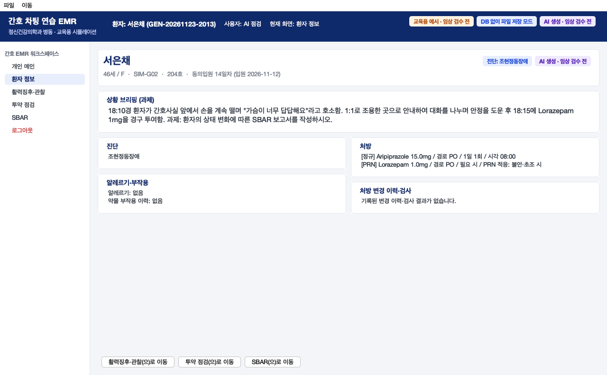
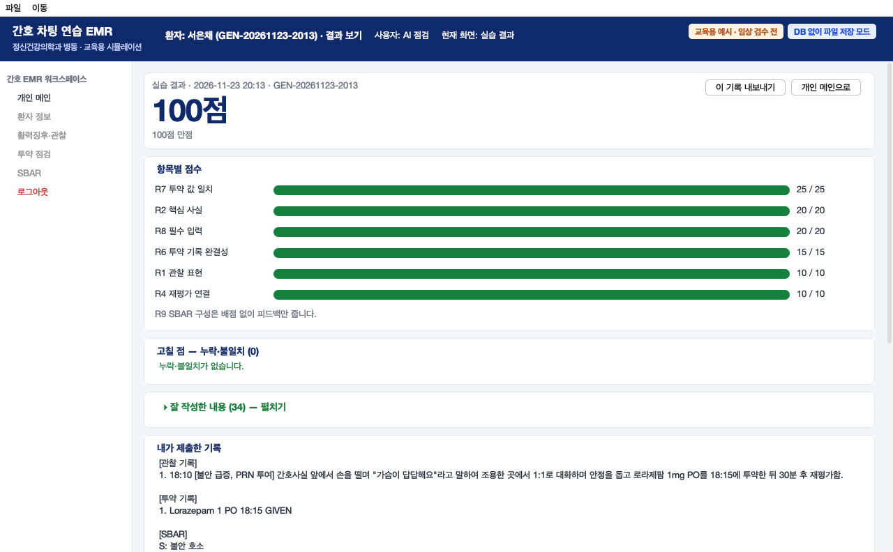
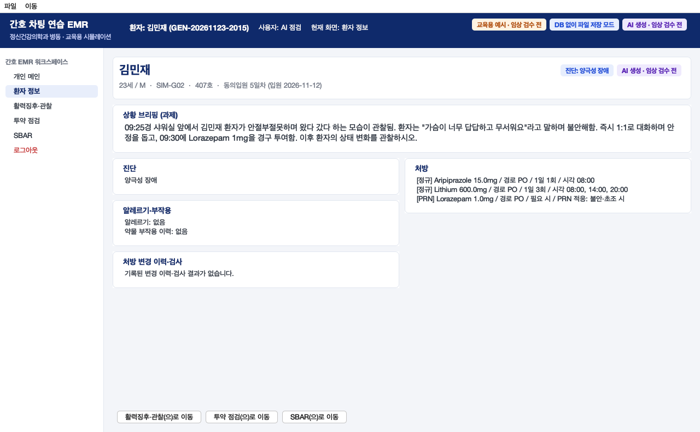
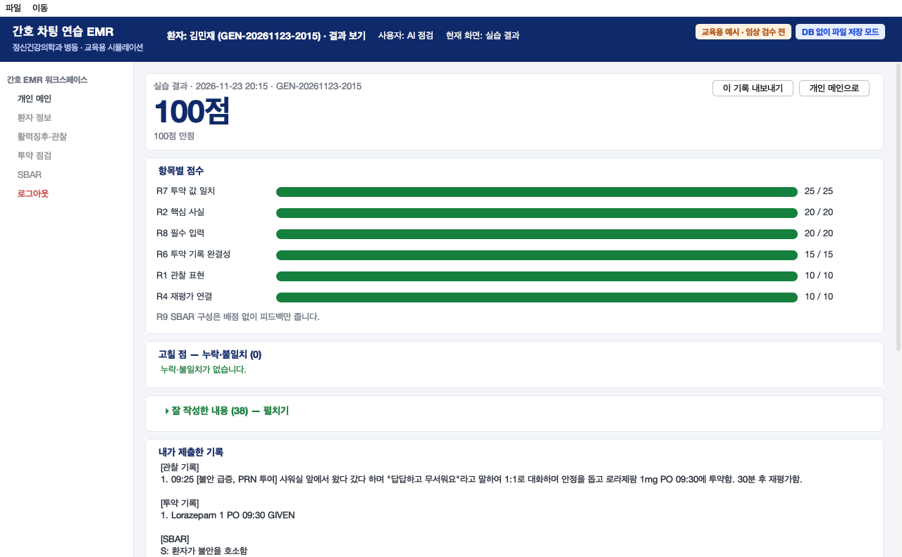
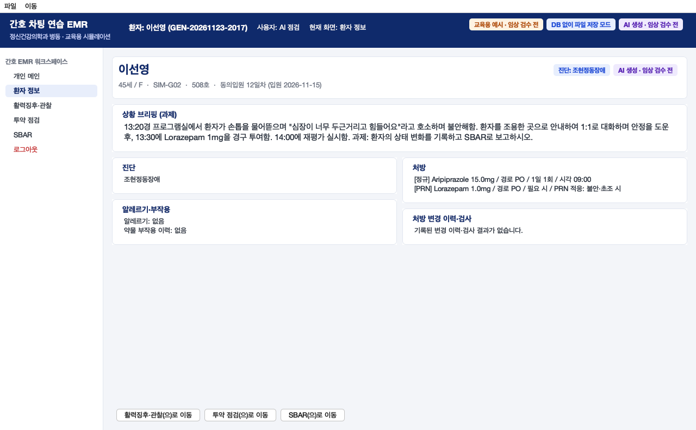
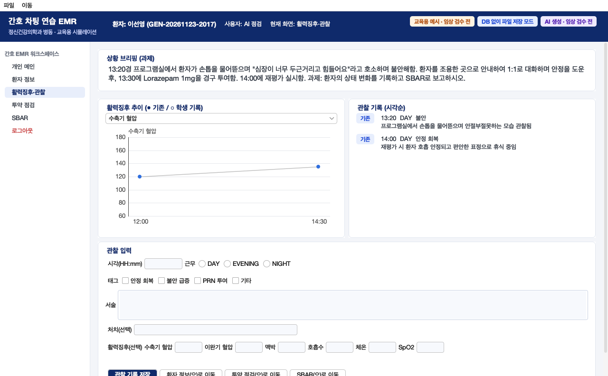
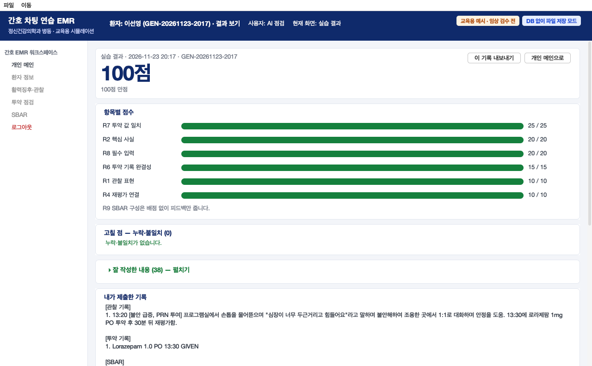
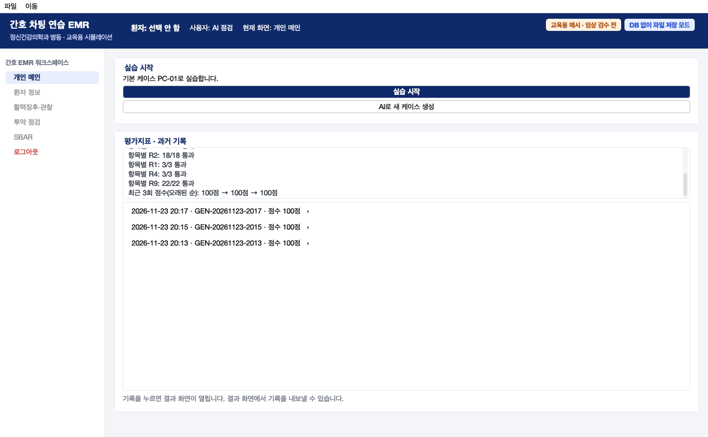

# 실제 AI 케이스 생성 3회 확인 (polish/1130 추가, 2026-11-23)

JAR 코드로 실제 창을 띄우고 실제 AI로 케이스를 3번 만들었다(파일 저장 모드, 임시 폴더, MySQL 계정 생성 없음).
각 케이스의 **구조화된 모범 기록을 학생처럼 화면에 입력해 제출**하고 점수를 확인했다. 생성 사이에는 1분 넘게 간격을 두어 ID 시각이 다르게 했다.
실행: `java -cp target/nursing-chart-trainer.jar:target/test-classes app.tools.UiWalkthrough docs/검증/polish/ai3 없는-db.properties config/ai.properties ai3`

캡처는 화면을 찍지 않고 프로그램 창만 그림 파일로 그렸다(다른 창이 섞이지 않게).

## 결과

| 회 | ID | 이름·나이·성별 | 병실 | 진단 | 사건 장소(정답 키) | 모범 기록 점수 | 브리핑 |
|---|---|---|---|---|---|---|---|
| 1 | GEN-20261123-2013 | 서은채 · 46세 · F | 204호 | 조현정동장애 | 간호사실 앞 | 100점 | 18:10경 환자가 간호사실 앞에서 손을 계속 떨며 "가슴이 너무 답답해요"라고 호소함. 1:1로 조용한 곳으로 안내하여 대화를 나누며 안정을 도운 후 18:15에 Lorazepam 1mg을 경구 투여함. 과제: 환자의 상태 변화에 따른 SBAR 보고서를 작성하시오. |
| 2 | GEN-20261123-2015 | 김민재 · 23세 · M | 407호 | 양극성 장애 | 샤워실 앞 | 100점 | 09:25경 샤워실 앞에서 김민재 환자가 안절부절못하며 왔다 갔다 하는 모습이 관찰됨. 환자는 "가슴이 너무 답답하고 무서워요"라고 말하며 불안해함. 즉시 1:1로 대화하며 안정을 돕고, 09:30에 Lorazepam 1mg을 경구 투여함. 이후 환자의 상태 변화를 관찰하시오. |
| 3 | GEN-20261123-2017 | 이선영 · 45세 · F | 508호 | 조현정동장애 | 프로그램실 | 100점 | 13:20경 프로그램실에서 환자가 손톱을 물어뜯으며 "심장이 너무 두근거리고 힘들어요"라고 호소하며 불안해함. 환자를 조용한 곳으로 안내하여 1:1로 대화하며 안정을 도운 후, 13:30에 Lorazepam 1mg을 경구 투여함. 14:00에 재평가 실시함. 과제: 환자의 상태 변화를 기록하고 SBAR로 보고하시오. |

전체 점검 결과: [result-table.md](result-table.md) (14/14 통과), 로그 [walkthrough.txt](walkthrough.txt)

## 캡처

| 회 | 환자 정보(브리핑) | 활력징후·관찰 | 결과(100점, 상단 환자·ID) |
|---|---|---|---|
| 1 |  |  |  |
| 2 |  |  |  |
| 3 |  |  |  |

과거 기록(ID로 구분): 

## 이번 확인에서 찾아 고친 것

| 처음 나온 문제 | 원인 | 고친 것 |
|---|---|---|
| 2·3회차가 3번씩 실패해 PC-01로 돌아감 | AI가 SBAR R 행 시각에 `EVENING`·`NIGHT`를 씀. 화면은 HH:mm만 받아 제출 불가 | 검사기가 모범 기록 시각 형식(HH:mm)을 검사, 프롬프트에 금지 명시 |
| 정답 키에 `재평가=…` | 견본의 자리 표시 `…`를 그대로 베낌 | 견본을 실제 낱말 예시로 바꾸고 자리 표시 금지 |
| `발언 인용`이 따옴표 포함 문장 전체 | 동의어 형식 안내 부족 | 따옴표 없이 핵심 낱말 1~3개로 안내 |
| 모범 관찰 기록에 `로라제팜\|Lorazepam&1mg…` | 만점을 맞추려고 정답 키 기호를 문장에 옮겨 적음 | 모범 기록에 `\|`·`&`가 있으면 거부 |
| 사건 장소·성씨·병실·진단이 반복(식당 2번, 성 박 3번, 302호 3번) | 무작위 선택이 겹치거나 AI가 같은 값을 고름 | 최근에 쓴 장소·성·병실·진단을 피해 제안하고, 최근 이름·장소·병실이면 거부 |
| 첫 실행 캡처에 다른 창이 섞임 | 화면 캡처(screencapture) 방식 | 창을 직접 그리는 방식으로 변경, 해당 캡처는 삭제(커밋 안 함) |

## 확인하지 못한 것·참고

- AI 응답은 매번 다르므로 3회 통과가 항상 통과를 뜻하지는 않는다. 검사에 3번 실패하면 PC-01로 돌아가고 안내한다.
- 브리핑의 간호 행위가 임상적으로 적절한지는 검수하지 않았다(화면에 `AI 생성 · 임상 검수 전` 표시). 이전 시도 중 한 번은 "격리실로 이동"처럼 근거 없는 처치를 쓴 브리핑이 나왔다.
- 이름 반복 방지는 프로그램을 켜 둔 동안만 기억한다(다시 켜면 처음부터).
