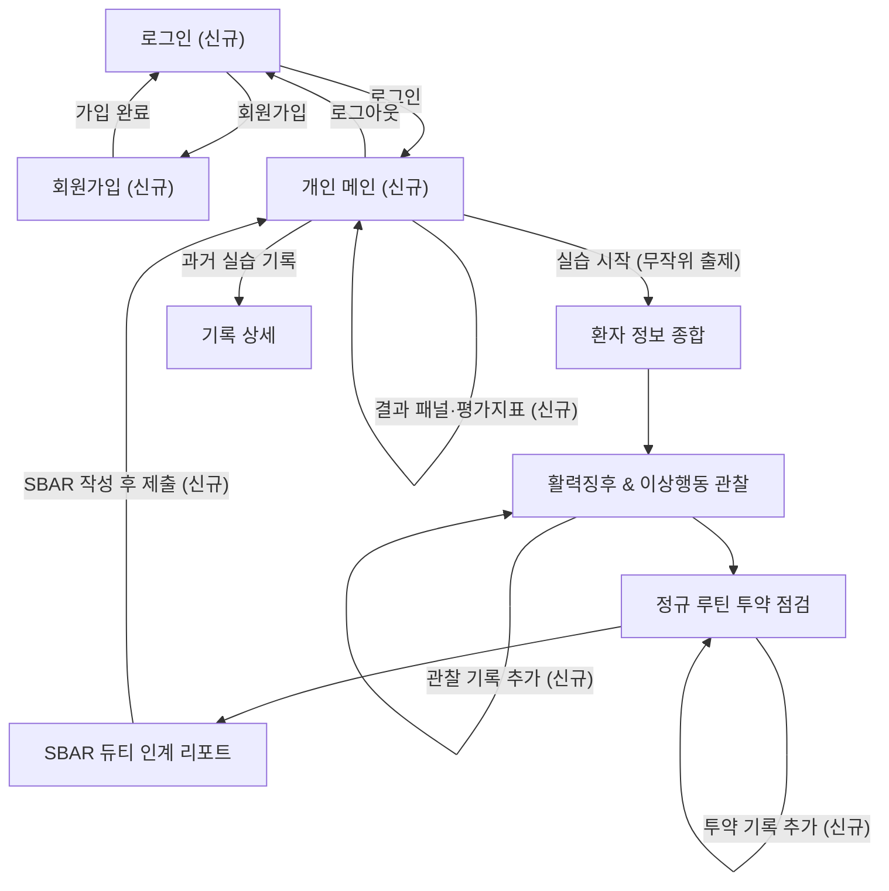

# 시나리오 — 사용자가 처음부터 끝까지 프로그램을 쓰는 흐름

| 항목 | 내용 |
|---|---|
| 상태 | **v0.3 — 결정 D13~D18 반영.** 화면·버튼 이름은 임시이고 Figma의 실제 이름으로 바꾼다 |
| 담당 | `TODO(팀)` |
| 용어 | **시나리오 = 사용자 흐름**(이 문서). 가상 환자 이야기는 **환자 케이스**([환자케이스.md](환자케이스.md)) |
| 관계 | 기능은 [기획안.md](기획안.md)의 F-xx, 점검은 R-x, 화면은 [화면명세.md](화면명세.md) |

> **`[신규]`** 는 디자인에 아직 없는 화면·요소다. [신규 화면 설계](design/신규화면-설계.md)를 보고 먼저 그린다.
> **`[확인필요]`** 는 환자 케이스의 값이 디자인과 대조 전이라는 뜻이다. 값이 확정되면 이 문서의 `expected`를 함께 고친다.

## 이 문서를 어디에 쓰나

1. **구현의 기준:** Claude는 이 흐름이 동작하도록 만든다. `steps`와 `expected`는 임의로 바꾸지 않는다.
2. **검증:** 구현 후 각 흐름을 자동 테스트와 사람의 눈으로 확인한다. `expected`는 **저장된 값·바뀐 상태·계산 결과**처럼 눈으로 확인할 수 있는 결과다.
3. **베타 테스트:** 간호학생이 이 흐름대로 써 보고 막히는 곳을 알려 준다.
4. 화면·버튼 이름이 바뀌면 이 문서도 같이 고친다.

## 1. 전체 흐름도



## 2. 주 사용 환경

- **플랫폼:** PC(Windows, macOS) 데스크톱 프로그램(Java Swing), 화면 기준 가로 1280px
- **이유:** 대상은 간호학부 3·4학년과 1년차 간호사다. 환자 정보를 읽으면서 관찰 기록과 인계 보고를 길게 써야 해서 넓은 화면과 키보드가 필요하다. 병동 EMR도 PC에서 쓴다. 휴대폰은 이번 범위가 아니다. `TODO(팀)`: 실제 사용 장면(실습실, 기숙사 개인 PC 등)을 확인해서 보강한다.
- **예시 사용자 P1:** 임상 실습을 앞두고 EMR 차팅을 처음 연습하는 간호학부 4학년

## 3. 흐름 목록

| ID | 흐름 | 계정 | 관련 기능 | 점검 |
|---|---|---|---|---|
| S1 | 회원가입, 로그인 실패, 로그인, 로그아웃 | 새 계정, 사용자A | F-13 | — |
| S2 | 개인 메인에서 실습을 시작하고 환자 정보를 읽는다 | 사용자A | F-01, F-02 | — |
| S3 | 활력징후와 관찰 로그를 읽고 **관찰 기록을 작성**한다 | 사용자A | F-03, F-04 | R1, R2, R8 |
| S4 | **투약 기록**을 작성한다(PRN, 구강 은닉 검사) | 사용자A | F-05 | R6, R7 |
| S5 | **SBAR 인계**를 작성해 제출하고, 필수 영역을 비우면 막힌다 | 사용자A | F-06, F-08 | R8, R9 |
| S6 | 제출 후 개인 메인에서 결과와 지적을 본다 | 사용자A | F-08, F-09 | R1, R4, R7 |
| S7 | AI 해설이 표시되고, AI 연결이 안 되면 점검 결과만 보인다 | 사용자A | F-10 | — |
| S8 | 과거 실습 기록과 평가지표를 보고, 다른 사용자의 기록은 안 보인다 | 사용자A, 사용자B | F-11, F-13 | — |

## 4. 골든 패스 — 기준이 되는 시나리오 하나 (PC-01)

> 처음부터 끝까지 **모든 점검이 통과하는 정상 경로**다. 구현이 끝나면 이 경로가 그대로 동작해야 하고, S2~S6의 입력값이 된다. 입력 문장은 환자케이스.md의 **모범 기록**을 쓴다.
> **로라제팜 PRN 용량은 디자인 안에서 0.5 mg과 1 mg로 불일치**한다([환자케이스.md](환자케이스.md) 불일치 1). 아래는 **임시로 1 mg** `[확인필요]`로 쓰고, 통일되면 고친다.

**준비**
- 계정: `golden01`(가상, 시드로 미리 만든다), 환자 케이스: **PC-01로 고정**(무작위 출제를 테스트에서 고정)

**단계와 입력**

| # | 화면 | 하는 일 (입력) |
|---|---|---|
| 1 | 로그인 | `golden01`로 로그인 → 개인 메인에서 `'실습 시작'` |
| 2 | 환자 정보 종합 | 병실 502호, 진단, 처방, 알레르기·부작용, 위험 지표를 읽는다 |
| 3 | 활력징후 & 이상행동 관찰 | 활력징후 표와 **추이 차트**, 기존 관찰 로그(07:30, 11:30)와 **상황 브리핑**을 읽는다 |
| 4 | 〃 `'관찰 기록 추가'` | 시각 `09:25`, 근무 `Day`, 분류 `불안 급증` `PRN 투여`, 서술: *데이실 구석에서 양손 엄지손톱을 피가 맺힐 정도로 과도하게 물어뜯는 행동이 관찰됨. "누군가 나를 감시하는 것 같아 숨이 가쁘다"고 호소함. 진정 지지 간호 시행 후 구두 처방에 따라 Ativan PO 투여 완료.* 처치: *투약 후 약효 평가 알림 등록. VAS 불안 8점 → PRN 투여.* → `'저장'` |
| 5 | 정규 루틴 투약 점검 `'투약 기록 추가'` | 약 `로라제팜`, 용량 `1 mg` `[확인필요]`, 경로 `PO`, 시각 `09:25`, 결과 `투여`, 사유 `불안 급증(VAS 8점)`, 처방 근거 `주치의 구두 처방`, 구강 은닉 검사 `확인`, 재평가 계획 `투약 후 약효 평가` → `'저장'` |
| 6 | 활력징후 & 이상행동 관찰 `'관찰 기록 추가'` | 시각 `11:30`, 근무 `Day`, 분류 `안정 회복`, 서술: *병실 내 침상에서 안정을 취하고 있음. 손톱 뜯기 행위가 소실됨. 간호사 면담 시 "아까보다 머리가 조용해졌어요"라고 진술하며 시선 접촉이 호전됨.* V/S `118/76-82-18-36.6` → `'저장'` |
| 7 | SBAR 듀티 인계 리포트 | `S` *09:25 불안 급증(VAS 8점)으로 구두 처방에 따라 로라제팜 1 mg PO를 투여했고, 재사정에서 안정되어 11:30 침상에서 안정 중임.* `B` *502호, Schizoaffective 진단 `[확인필요]`, 아리피프라졸 10 mg 아침 식후, 리튬 복용 중 혈중 농도 0.78 mEq/L로 안정적, 타 병원 할로페리돌 근주 후 급성 근긴장이상 이력 `[확인필요]`.* `A` *피해·관계사고가 잔존하며 타 환자 행동을 살피는 경계태세가 지속됨. 환청은 감소했으나 병식은 부분적임. 구강 은닉 검사 결과 `[확인필요]`.* `R` 행 추가: *다음 듀티 15분 간격 안전 라운딩 유지(자해 감시 Tier 2)* / *불안 재발 시 VAS 평가 후 PRN 재사정* `[임시 문장 — 디자인의 R 체크리스트로 교체]` → `'제출'` |
| 8 | 개인 메인 | 방금 제출한 실습의 `'결과 보기'` |

**기대 결과 (골든 패스)**
- 개인 메인으로 돌아가 **과거 실습 기록에 새 항목**이 생기고 평가지표의 실습 횟수가 1이 된다
- 결과 패널: `'잘못 쓴 내용'`과 `'누락한 내용'`이 **비어 있고**, `'잘 쓴 내용'`에 ① 환자 발언을 따옴표로 인용함(R1) ② 투약 용량·약명·경로가 처방과 일치(R7) ③ 약효 평가 계획이 있음(R4) ④ 필수 입력 완료(R8) ⑤ SBAR 네 영역 구성(R9)이 보인다
- 모든 점검이 통과하므로 **총점은 만점**이다(가중치 확정 전 `TODO(팀)`)
- 저장된 결과 파일에 관찰 기록 2건, 투약 기록 1건, SBAR이 **입력한 그대로** 들어 있다

**골든 패스의 변형 (일부러 틀린 입력)** — 점검 테스트용

| 변형 | 바꾸는 것 | 기대하는 지적 |
|---|---|---|
| V1 | 4단계 서술을 `환자는 피해망상이 심하고 불안해 보임`으로 | R1 `'잘못 쓴 내용'`에 그 문장 하이라이트, 이유 "판단 표현"(표현 목록은 확정 전) |
| V2 | 4단계 서술에서 따옴표 없이 `감시당하는 것 같다고 함` | R1 `'잘못 쓴 내용'`: 환자 발언 인용 누락 |
| V3 | 5단계 용량을 처방의 2배로 | R7 `'잘못 쓴 내용'`: 처방 용량과 다름(어느 칸인지 표시) |
| V4 | 4·5단계에서 약효 평가·재평가 계획을 비움 | R4 `'누락한 내용'`: 재평가 연결 누락 |
| V5 | 7단계에서 `B`를 비우고 제출 | 제출 거부, 비어 있는 `B` 안내(R8) |
| V6 | 5단계에서 약을 `거부`로 바꾸고 사유를 비움 | R6: 거부는 사유 필수 |

## 5. 흐름 상세

> 표기: 버튼·입력 칸 이름은 `'작은따옴표'`. 모두 **임시 이름**이다 (`TODO(디자인 담당)`).
> 입력값은 위 **골든 패스**를 쓴다.

### S1. 회원가입, 로그인 실패, 로그인, 로그아웃

- **계정:** 새 계정(실행마다 다른 아이디), 이어서 사용자A(미리 만든 가상 계정)
- **관련 기능:** F-13 / 화면: 로그인, 회원가입 `[신규]`
- **steps**
  1. 로그인 화면에서 `'회원가입'`을 누른다
  2. 이름 `홍길동`, 아이디 `test01`, 비밀번호 `Test1234!`(가상 값), 비밀번호 확인, 소속·경력 단계 `간호학부 4학년`을 입력한다
  3. `'가입하기'`를 누른다
  4. 로그인 화면에서 같은 아이디와 **틀린 비밀번호**로 `'로그인'`을 누른다
  5. 올바른 비밀번호로 `'로그인'`을 누른다
  6. 개인 메인에서 `'로그아웃'`을 누른다
- **expected:** 4단계에서는 넘어가지 않고 "아이디 또는 비밀번호가 맞지 않습니다"가 보인다(**어느 쪽이 틀렸는지 알려 주지 않음**). 5단계에서 개인 메인이 열리고 `홍길동`이 보인다. 6단계 후 로그인 화면이 보이며 이전 사용자 이름이 남아 있지 않다. 저장된 계정 파일에 비밀번호 `Test1234!`가 **그대로 없고** 해시와 솔트만 있다.
- **별도 확인:** 이미 있는 아이디로 가입하면 "이미 사용 중인 아이디"가 보이고 계정이 늘지 않는다.

### S2. 개인 메인에서 실습을 시작하고 환자 정보를 읽는다

- **계정:** 사용자A / **관련 기능:** F-01, F-02 / 화면: 개인 메인 `[신규]`, 환자 정보 종합
- **준비:** 무작위 출제를 **PC-01로 고정**
- **steps**
  1. 개인 메인에서 `'실습 시작'`을 누른다
  2. 환자 정보 종합 화면에서 병실, 진단, 알레르기·부작용, 현재 처방, 위험 지표를 확인한다
  3. 왼쪽 메뉴에서 `'활력징후 & 이상행동 관찰'`을 누른다
- **expected:** 환자 정보 종합에 PC-01의 값(502호, 처방 목록, 위험 지표 `Tier 2`)이 케이스 파일과 **같게** 보인다. 활력징후 & 이상행동 관찰 화면이 열린다. 화면에 **"교육용 예시 · 임상 검수 전"** 이 표시된다. **정답 키와 모범 기록은 보이지 않는다.** 왼쪽 메뉴에는 MVP 화면 5개와 로그아웃만 있다.

### S3. 관찰 로그를 읽고 관찰 기록을 작성한다

- **계정:** 사용자A / **관련 기능:** F-03, F-04 / **점검:** R1, R2, R8 / 화면: 활력징후 & 이상행동 관찰 + 입력 영역 `[신규]`
- **steps**
  1. 활력징후 값과 **추이 차트**, 기존 관찰 로그(07:30, 11:30), 상황 브리핑을 읽는다
  2. `'관찰 기록 추가'`를 누른다 `[신규]`
  3. 골든 패스 4단계의 시각·근무·분류·서술·처치를 입력한다
  4. `'저장'`을 누른다
- **expected:** 관찰 로그에 `09:25` 항목이 **시각 순서**(07:30과 11:30 사이)로 추가되고, 분류 태그 `불안 급증` `PRN 투여`, 서술, 처치가 입력한 그대로 보인다. **서술이 비어 있으면 저장되지 않고** 이유가 보인다. 활력징후 추이 차트가 케이스의 값(09:30 HR 94, 11:30 HR 80 `[확인필요]`)대로 그려진다.

### S4. 투약 기록을 작성한다

- **계정:** 사용자A / **관련 기능:** F-05 / **점검:** R6, R7 / 화면: 정규 루틴 투약 점검 + 입력 영역 `[신규]`
- **steps**
  1. 왼쪽 메뉴에서 `'정규 루틴 투약 점검'`을 누르고 처방 표와 복용 상태를 확인한다
  2. `'투약 기록 추가'`를 누른다 `[신규]`
  3. 골든 패스 5단계의 약·용량·경로·시각·결과·사유·처방 근거·구강 은닉 검사·재평가 계획을 입력한다
  4. `'저장'`을 누른다
- **expected:** 투약 기록 목록에 `로라제팜 1 mg PO 09:25 투여`와 사유가 보인다. **결과를 `거부`로 하고 사유를 비우면 저장되지 않는다**(V6). 약 목록은 **처방에 있는 약만** 선택할 수 있다.

### S5. SBAR 인계를 작성해 제출하고, 필수 영역을 비우면 막힌다

- **계정:** 사용자A / **관련 기능:** F-06, F-08 / **점검:** R8, R9 / 화면: SBAR 듀티 인계 리포트 + 입력 영역 `[신규]`
- **steps**
  1. 왼쪽 메뉴에서 `'SBAR 듀티 인계 리포트'`를 누른다
  2. `S` 영역에만 내용을 입력한다
  3. `'제출'`을 누른다
  4. 안내를 확인하고 `B`, `A`, `R` 영역을 골든 패스 7단계대로 입력한다
  5. `'제출'`을 누른다
- **expected:** 3단계에서는 **넘어가지 않고** 비어 있는 영역(`B`, `A`, `R`)이 안내되며 `S` 입력은 그대로 남는다. 5단계 후 개인 메인으로 돌아가고 과거 실습 기록에 새 항목이 생긴다.

### S6. 제출 후 개인 메인에서 결과와 지적을 본다

- **계정:** 사용자A / **관련 기능:** F-08, F-09 / **점검:** R1, R4, R7 / 화면: 개인 메인 결과 패널 `[신규]`
- **준비:** 골든 패스의 변형 V1(판단 표현), V3(용량 2배), V4(재평가 누락)를 한 번에 넣은 입력
- **steps**
  1. 변형 입력으로 관찰 기록·투약 기록·SBAR을 작성하고 제출한다
  2. 개인 메인에서 방금 제출한 항목의 `'결과 보기'`를 누른다
- **expected:** 결과 패널의 `'잘못 쓴 내용'`에 ① 관찰 서술의 그 문장이 **하이라이트**되고 이유가 "판단 표현"으로 보이며 ② 투약 용량이 처방과 다르다는 지적이 **투약 기록의 용량 칸**으로 표시되고, `'누락한 내용'`에 ③ 약효 평가(재평가) 계획 누락이 나온다. 모든 지적은 **어느 칸의 어느 문장인지** 보인다. 골든 패스를 입력했을 때는 `'잘못 쓴 내용'`과 `'누락한 내용'`이 비어 있다.

### S7. AI 해설이 표시되고, AI 연결이 안 되면 점검 결과만 보인다

- **계정:** 사용자A / **관련 기능:** F-10
- **준비:** 테스트에서는 실제 AI 대신 **가짜 응답**으로 성공·실패를 만든다
- **steps**
  1. S6과 같이 제출하고 결과 패널을 연다
  2. `'AI 해설'` 영역을 본다
  3. (AI 연결이 끊긴 상태로) 같은 입력을 다시 제출한다
- **expected:** 연결되면 `'AI 해설'`에 좋은 점, 개선점, 개선된 예시가 보이고 **점수는 AI 해설 때문에 바뀌지 않는다.** 연결이 안 되면 "AI 해설을 불러오지 못했습니다"가 보이고 규칙 점검 결과와 점수는 그대로다. 어느 경우에도 화면이 멈추지 않는다.

### S8. 과거 실습 기록과 평가지표를 보고, 다른 사용자의 기록은 안 보인다

- **계정:** 사용자A, 이어서 사용자B / **관련 기능:** F-11, F-13 / 화면: 개인 메인 `[신규]`
- **steps**
  1. (사용자A) 개인 메인에서 `'과거 실습 기록'`을 연다
  2. 목록의 첫 번째 기록을 연다
  3. `'평가지표'`를 본다
  4. `'로그아웃'`을 누르고 사용자B로 로그인한 뒤 `'과거 실습 기록'`을 연다
- **expected:** 2단계에서 환자 케이스 이름, 제출 일시, 점수가 보이고 열면 **제출했을 때의 입력과 점검 결과가 그대로** 보인다. 3단계의 평가지표에는 실습 횟수와 점검 항목별 점수(R1, R6·R7, R8, R9)가 사용자A의 기록과 일치하게 보인다. 4단계에서 사용자B의 목록에는 사용자A의 기록이 **보이지 않는다.**

## 6. 공통 원칙

- **가상 데이터만 쓴다.** 실제 환자·개인 정보를 쓰지 않는다.
- **흐름은 서로의 데이터에 기대지 않는다.** 흐름마다 필요한 계정과 기록을 스스로 준비한다.
- **무작위 출제는 환자 케이스를 고정**할 수 있어야 한다(테스트·시연용).
- **AI 키 없이도 S1~S6, S8이 통과**해야 한다. AI는 S7에서만 가짜 응답으로 확인한다.
- **정답 키와 모범 기록은 제출 전에 사용자에게 보이지 않는다.**

## 7. 흐름을 쓰는 규칙

| 항목 | 규칙 |
|---|---|
| `steps` | 1~12단계. 한 줄에 한 동작. **화면에 보이는 버튼·메뉴 이름 그대로**, 처음 보는 사람이 따라 할 수 있게 쓴다 |
| `expected` | **눈으로 확인할 수 있는 결과**: 저장된 값, 바뀐 상태, 계산 결과, 안내 문구 |
| 개수 | 핵심 흐름 3~8개. 기능 수를 채우려고 늘리지 않는다 |
| 이름 | 화면·버튼 이름이 바뀌면 이 문서와 테스트를 **같은 커밋에서** 고친다 |
| 연결 | 모든 흐름은 기능(F-xx)에 연결된다. 기획안에 없는 기능을 여기서 새로 만들지 않는다 |

## 8. 새 흐름 양식

```
### S9. <누가 무엇을 이루는 흐름인지 한 문장>

- 계정: 
- 관련 기능: F-xx / 점검: R-x
- 준비: (고정할 환자 케이스, 필요한 계정)
- steps
  1. 
- expected: 
```

## 9. 확인할 것 (`TODO(팀)`)

1. 화면·버튼 이름을 Figma와 맞춘다 (`TODO(디자인 담당)`)
2. **로라제팜 용량 불일치**가 해소되면 골든 패스 5·7단계와 S4를 고친다
3. SBAR의 R 문장을 디자인의 체크리스트 항목으로 교체한다
4. 로그인 정책(비밀번호 최소 길이 등)이 정해지면 S1을 고친다 (tasks D-14)
5. 판단 표현 목록(V1)은 근거를 찾은 뒤 확정한다 (tasks D-06)
6. 총점 가중치가 정해지면 "만점" 기준을 고친다
