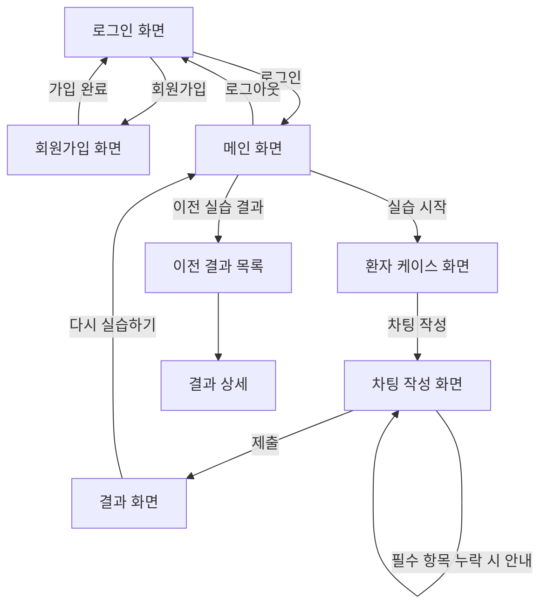

# 시나리오 — 사용자가 처음부터 끝까지 프로그램을 쓰는 흐름

| 항목 | 내용 |
|---|---|
| 상태 | **초안.** 화면·버튼 이름은 임시이고 Figma 디자인에 맞춰 고쳐야 한다 |
| 담당 | `TODO(팀)` |
| 용어 | **시나리오 = 사용자 흐름**(이 문서). 가상 환자 이야기는 **환자 케이스**라고 부른다 → [환자케이스.md](환자케이스.md) |
| 관계 | 기능은 [기획안.md](기획안.md)의 F-xx, 화면은 [화면명세.md](화면명세.md), 점검은 기획안의 R1~R8 |

## 이 문서를 어디에 쓰나

1. **구현의 기준:** Claude는 이 흐름이 동작하도록 만든다. 흐름의 `steps`와 `expected`는 **바꾸지 않는다.** 바꿔야 하면 팀에 묻는다.
2. **검증:** 구현이 끝나면 각 흐름을 자동 테스트와 사람의 눈으로 확인한다. `expected`는 "화면이 열린다"가 아니라 **저장된 값·바뀐 상태·계산 결과**처럼 눈으로 확인할 수 있는 결과다.
3. **베타 테스트:** 간호학생이 이 흐름대로 써 보고 막히는 곳을 알려 준다.
4. 화면·버튼 이름을 바꾸면 **이 문서도 같은 시점에 고친다.**

## 1. 전체 흐름도



## 2. 주 사용 환경

- **플랫폼:** PC (Windows, macOS) 데스크톱 프로그램 (Java Swing)
- **이유:** 대상은 간호학부 3·4학년과 1년차 간호사다. 환자 정보·대화록을 읽으면서 SOAPIE·MSE·투약 기록을 길게 입력해야 해서, 넓은 화면과 키보드가 필요하다. 병동 EMR도 PC에서 쓴다. 휴대폰 사용은 이번 범위가 아니다. `TODO(팀)`: 실제 사용 장면(실습실, 기숙사 개인 PC 등)을 확인해서 이유를 보강한다.
- **예시 사용자 P1:** 임상 실습을 앞두고 EMR 차팅을 처음 연습하는 간호학부 4학년. 기숙사에서 개인 노트북으로 반복 연습한다.

## 3. 흐름 목록

| ID | 흐름 | 계정 | 관련 기능 | 관련 점검 |
|---|---|---|---|---|
| S1 | 새 사용자가 회원가입하고 로그인한다 | 없음(새 계정) | F-13 | — |
| S2 | 로그인에 실패하면 거부되고, 로그아웃하면 로그인 화면으로 돌아간다 | 사용자A | F-13 | — |
| S3 | 실습을 시작해 환자 케이스를 읽는다 | 사용자A | F-01, F-02, F-03 | — |
| S4 | 필수 항목을 비우고 제출하면 막힌다 | 사용자A | F-04, F-08 | R8 |
| S5 | SOAPIE·MSE·위험사정·투약 기록을 모두 작성해 제출하고 결과를 본다 | 사용자A | F-04~F-09 | R1~R8 |
| S6 | 판단 표현과 틀린 수치·약물 용량이 지적된다 | 사용자A | F-08, F-09 | R1, R7 |
| S7 | AI 해설이 표시되고, AI 연결이 안 되면 점검 결과만 보인다 | 사용자A | F-10 | — |
| S8 | 이전 결과를 조회하고 다시 실습한다(다른 사용자의 결과는 안 보인다) | 사용자A, 사용자B | F-11, F-13 | — |

**한도 밖 후보**(필요하면 S5의 변형으로 추가): 위험사정을 중심으로 한 흐름(환자 케이스 PC-02, R3), 투약 거부 기록 흐름(PC-01, R6), MSE 흐름.

## 4. 흐름 상세

> 표기: 버튼·메뉴 이름은 `'작은따옴표'`로 쓴다. **모두 임시 이름**이고, Figma 디자인의 실제 이름으로 바꾼다 (`TODO(디자인 담당)`).
> 환자 케이스 값(이름, 수치, 처방)은 [환자케이스.md](환자케이스.md)의 **현재 초안** 기준이다. 케이스를 고치면 이 `expected`도 같이 고친다.

### S1. 새 사용자가 회원가입하고 로그인한다

- **계정:** 없음. 이 흐름이 새 계정을 만든다(다시 실행해도 겹치지 않게 아이디는 실행마다 다르게)
- **관련 기능:** F-13
- **steps**
  1. 로그인 화면에서 `'회원가입'`을 누른다
  2. 이름에 `홍길동`, 아이디에 `test01`, 비밀번호에 `Test1234!`(가상 값), 소속·경력 단계에 `간호학부 4학년`을 입력한다
  3. `'가입하기'`를 누른다
  4. 로그인 화면에서 아이디와 비밀번호를 입력하고 `'로그인'`을 누른다
- **expected:** 메인 화면에 사용자 이름 `홍길동`이 보이고 `'실습 시작'`, `'이전 실습 결과'`, `'로그아웃'`이 보인다. 저장된 계정 파일에는 비밀번호 `Test1234!`가 **그대로 들어 있지 않고** 해시와 솔트만 있다.
- **같은 흐름의 실패 변형(별도 확인):** 이미 있는 아이디로 가입하면 "이미 사용 중인 아이디" 안내가 보이고 계정이 늘지 않는다.

### S2. 로그인에 실패하면 거부되고, 로그아웃하면 로그인 화면으로 돌아간다

- **계정:** 사용자A(미리 만들어 둔 가상 계정)
- **관련 기능:** F-13
- **steps**
  1. 로그인 화면에서 사용자A의 아이디와 **틀린 비밀번호**를 입력하고 `'로그인'`을 누른다
  2. 올바른 비밀번호를 입력하고 `'로그인'`을 누른다
  3. 메인 화면에서 `'로그아웃'`을 누른다
- **expected:** 1단계에서는 메인 화면으로 넘어가지 않고 "아이디 또는 비밀번호가 맞지 않습니다" 안내가 보인다(**어느 쪽이 틀렸는지는 알려 주지 않는다**). 2단계에서 메인 화면이 열리고, 3단계 후에는 로그인 화면이 보이며 이전 사용자의 이름이 어디에도 남아 있지 않다.

### S3. 실습을 시작해 환자 케이스를 읽는다

- **계정:** 사용자A
- **관련 기능:** F-01, F-02, F-03
- **준비:** 테스트에서는 무작위 출제를 **환자 케이스 PC-01로 고정**할 수 있어야 한다(개발용 설정).
- **steps**
  1. 메인 화면에서 `'실습 시작'`을 누른다
  2. 환자 정보 영역에서 이름, 나이, 진단, 알레르기, 처방, 활력징후를 확인한다
  3. `'이전 차팅'`을 눌러 이전 기록을 연다
  4. 면담 대화록과 관찰 메모를 스크롤하며 끝까지 읽는다
- **expected:** 환자 정보에 `김서준`, `27세`, 처방 2개(리스페리돈, 로라제팜), 활력징후 `128/82, 88, 18, 36.7, 98%`가 환자 케이스 파일과 같게 보인다. 대화록은 15줄, 관찰 메모는 4줄이 보인다. 화면에 **"교육용 예시 · 임상 검수 전"** 이 표시된다. 정답 키와 모범 차팅은 **보이지 않는다**.

### S4. 필수 항목을 비우고 제출하면 막힌다

- **계정:** 사용자A
- **관련 기능:** F-04, F-08 / **점검:** R8
- **steps**
  1. 메인 화면에서 `'실습 시작'`을 누른다
  2. 환자 케이스 화면에서 `'차팅 작성'`을 누른다
  3. `S` 칸에만 `약을 안 먹겠다고 함`을 입력한다
  4. `'제출'`을 누른다
- **expected:** 결과 화면으로 **넘어가지 않고**, 비어 있는 필수 칸 이름(`O`, `A`, `P`, `I`, `E`)이 안내된다. `S`에 입력한 내용은 그대로 남아 있다. `'이전 실습 결과'` 목록에 새 항목이 생기지 않는다.

### S5. SOAPIE·MSE·위험사정·투약 기록을 모두 작성해 제출하고 결과를 본다

- **계정:** 사용자A
- **관련 기능:** F-04, F-05, F-06, F-07, F-08, F-09 / **점검:** R1~R8
- **준비:** 환자 케이스 PC-01 고정. 입력 문장은 [환자케이스.md](환자케이스.md)의 모범 차팅을 쓴다(테스트 입력 자료).
- **steps**
  1. 메인 화면에서 `'실습 시작'`을 누른다
  2. 환자 케이스 화면에서 `'차팅 작성'`을 누른다
  3. `S` 칸에 모범 차팅의 S 내용을 입력한다
  4. `O` 칸에 모범 차팅의 O 내용을 입력하고 `'정신상태검사'` 탭에서 항목을 선택한다
  5. `'투약 기록'`에서 리스페리돈 `거부`, 시각 `08:00`, 사유 `약 안에 뭘 넣었어요`를 입력한다
  6. `'위험사정'`에서 질문과 환자 답변을 입력한다
  7. `A`, `P`, `I`, `E` 칸을 각각 입력한다
  8. `'제출'`을 누른다
- **expected:** 결과 화면이 열리고, **총점**과 항목별 점검 결과가 `'잘 쓴 내용'`, `'누락한 내용'`, `'잘못 쓴 내용'`으로 나뉘어 보인다. 모든 필수 칸을 채웠으므로 필수 입력란 지적은 없다. 저장된 결과 파일에 입력한 S/O/MSE/A/P/I/E 텍스트, 투약 기록, 위험사정, 점검 결과, 제출 시각이 들어 있다.

### S6. 판단 표현과 틀린 수치·약물 용량이 지적된다

- **계정:** 사용자A
- **관련 기능:** F-08, F-09 / **점검:** R1, R7
- **준비:** 환자 케이스 PC-01 고정
- **steps**
  1. 메인 화면에서 `'실습 시작'`을 누르고 `'차팅 작성'`을 누른다
  2. `S`, `A`, `P`, `I`, `E` 칸은 모범 차팅대로 입력한다
  3. `O` 칸에 `환자는 망상이 심하고 불안해 보임`을 입력한다(판단 표현. 표현 목록은 확정 전 `[검증필요]`)
  4. 활력징후 입력 칸에 혈압 `150/90`을 입력한다(케이스 값은 128/82)
  5. `'투약 기록'`에서 리스페리돈 용량을 `5mg`으로 입력한다(처방은 2mg)
  6. `'제출'`을 누른다
- **expected:** `'잘못 쓴 내용'`에 ① `O`의 그 문장이 하이라이트되고 이유가 "판단 표현"으로 표시되며 ② 혈압이 케이스 값(128/82)과 다르다는 지적이 나오고 ③ 리스페리돈 용량이 처방(2mg)과 다르다는 지적이 나온다. 세 지적 모두 **어느 칸의 어느 문장인지** 보인다.

### S7. AI 해설이 표시되고, AI 연결이 안 되면 점검 결과만 보인다

- **계정:** 사용자A
- **관련 기능:** F-10
- **준비:** 테스트에서는 **실제 AI 대신 가짜 응답**으로 성공·실패를 만든다(비용·키 문제 방지)
- **steps**
  1. S5와 같이 차팅을 작성해 `'제출'`을 누른다
  2. 결과 화면에서 `'AI 해설'` 영역을 본다
  3. (AI 연결이 끊긴 상태로) 다시 같은 차팅을 제출한다
- **expected:** 연결이 되면 `'AI 해설'`에 좋은 점, 개선할 점, 개선된 차팅 예시가 보이고 **점수는 AI 해설 때문에 바뀌지 않는다**. 연결이 안 되면 `'AI 해설을 불러오지 못했습니다'` 안내가 보이고 규칙 점검 결과와 점수는 그대로 보인다. 어느 경우에도 화면이 멈추지 않는다.

### S8. 이전 결과를 조회하고 다시 실습한다 (다른 사용자의 결과는 안 보인다)

- **계정:** 사용자A, 이어서 사용자B
- **관련 기능:** F-11, F-13
- **steps**
  1. (사용자A) 결과 화면에서 `'다시 실습하기'`를 누른다
  2. 메인 화면에서 `'이전 실습 결과'`를 누른다
  3. 목록의 첫 번째 결과를 연다
  4. `'로그아웃'`을 누르고 사용자B로 로그인한 뒤 `'이전 실습 결과'`를 누른다
- **expected:** 3단계에서 환자 케이스 이름, 제출 일시, 점수가 보이고, 열면 **제출했을 때의 입력 내용과 점검 결과가 그대로** 보인다. 4단계에서 사용자B의 목록에는 사용자A의 결과가 **보이지 않는다**.

## 5. 공통 원칙

- **가상 데이터만 쓴다.** 실제 환자·개인 정보는 쓰지 않는다.
- **흐름은 서로의 데이터에 기대지 않는다.** 흐름마다 필요한 계정과 결과를 스스로 준비한다.
- **무작위 출제는 환자 케이스 ID로 고정할 수 있어야 한다**(테스트·시연용 설정).
- **AI 키 없이도 S1~S6, S8이 통과해야 한다.** AI는 S7에서만 가짜 응답으로 확인한다.
- **정답 키와 모범 차팅은 결과 화면 이전에 사용자에게 보이지 않는다.**

## 6. 흐름을 쓰는 규칙

| 항목 | 규칙 |
|---|---|
| `steps` | 1~12단계. 한 줄에 한 동작. **화면에 보이는 버튼·메뉴 이름 그대로**, 처음 보는 사람이 따라 할 수 있게 쓴다 |
| `expected` | **눈으로 확인할 수 있는 결과**: 저장된 값, 바뀐 상태, 계산 결과, 안내 문구. "화면이 열린다"만 쓰지 않는다 |
| 개수 | 핵심 흐름 3~8개. 기능 수를 채우려고 흐름을 늘리지 않는다 |
| 이름 | 화면·버튼 이름이 바뀌면 이 문서와 테스트를 **같은 커밋에서** 고친다 |
| 연결 | 모든 흐름은 기능(F-xx)에 연결된다. 기획안에 없는 기능을 이 문서에서 새로 만들지 않는다 |

## 7. 새 흐름 양식

```
### S9. <누가 무엇을 이루는 흐름인지 한 문장>

- 계정: 
- 관련 기능: F-xx / 점검: R-x
- 준비: (고정할 환자 케이스, 필요한 계정)
- steps
  1. 
- expected: 
```

## 8. 확인할 것 (`TODO(팀)`)

1. 화면·버튼 이름을 Figma와 맞춘다 (`TODO(디자인 담당)`)
2. 흐름 순서가 디자인의 화면 전환과 같은지 확인한다
3. 8개 한도 안에서 빠진 핵심 흐름이 없는지(위험사정, 투약 거부 등) 정한다
4. 로그인 정책(비밀번호 최소 길이 등)이 정해지면 S1·S2를 고친다 (tasks D-14)
5. 판단 표현 예시(S6)는 근거를 찾은 뒤 확정한다 (tasks D-06)
