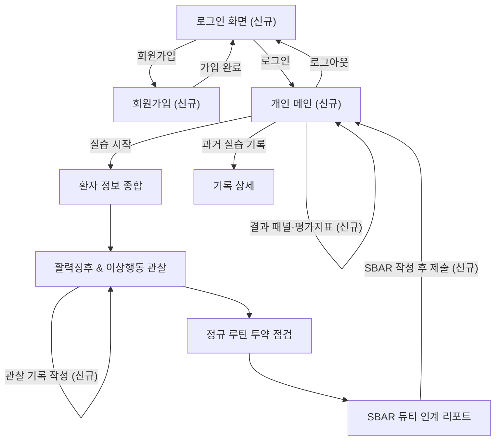

# 시나리오 — 사용자가 처음부터 끝까지 프로그램을 쓰는 흐름

| 항목 | 내용 |
|---|---|
| 상태 | **가안 v0.2 (디자인 확인 반영).** 학생이 쓰는 입력 화면이 디자인에 없어서 **[기획안 4-1장](기획안.md)의 결정(가안 C)을 전제**로 썼다. 결정이 바뀌면 이 문서를 고친다 |
| 담당 | `TODO(팀)` |
| 용어 | **시나리오 = 사용자 흐름**(이 문서). 가상 환자 이야기는 **환자 케이스**라고 부른다 → [환자케이스.md](환자케이스.md) |
| 관계 | 기능은 [기획안.md](기획안.md)의 F-xx, 화면은 [화면명세.md](화면명세.md) |

> **`[신규]` 표시는 디자인에 아직 없는 화면·요소**다. 먼저 그려야 구현할 수 있다. 버튼·입력 칸 이름은 **임시**이고 Figma의 실제 이름으로 바꾼다.

## 이 문서를 어디에 쓰나

1. **구현의 기준:** Claude는 이 흐름이 동작하도록 만든다. `steps`와 `expected`는 임의로 바꾸지 않는다.
2. **검증:** 구현 후 각 흐름을 자동 테스트와 사람의 눈으로 확인한다. `expected`는 **저장된 값·바뀐 상태·계산 결과**처럼 눈으로 확인할 수 있는 결과다.
3. **베타 테스트:** 간호학생이 이 흐름대로 써 보고 막히는 곳을 알려 준다.
4. 화면·버튼 이름이 바뀌면 이 문서도 같이 고친다.

## 1. 전체 흐름도



## 2. 주 사용 환경

- **플랫폼:** PC(Windows, macOS) 데스크톱 프로그램(Java Swing), 화면 기준 가로 1280px
- **이유:** 대상은 간호학부 3·4학년과 1년차 간호사다. 환자 정보를 읽으면서 관찰 기록과 인계 보고를 길게 써야 해서 넓은 화면과 키보드가 필요하다. 병동 EMR도 PC에서 쓴다. 휴대폰은 이번 범위가 아니다. `TODO(팀)`: 실제 사용 장면(실습실, 기숙사 개인 PC 등)을 확인해서 보강한다.
- **예시 사용자 P1:** 임상 실습을 앞두고 EMR 차팅을 처음 연습하는 간호학부 4학년

## 3. 흐름 목록

| ID | 흐름 | 계정 | 관련 기능 | 점검 |
|---|---|---|---|---|
| S1 | 새 사용자가 회원가입하고 로그인하며, 실패하면 거부되고, 로그아웃하면 돌아간다 | 새 계정, 사용자A | F-13 | — |
| S2 | 개인 메인에서 실습을 시작하고 환자 정보를 읽는다 | 사용자A | F-01, F-02 | — |
| S3 | 활력징후와 이상행동 관찰 기록을 읽고, 관찰 기록을 작성한다 | 사용자A | F-03 | R1, R8 |
| S4 | 정규 루틴 투약 점검에서 복용을 확인·기록한다 | 사용자A | F-07 | R6, R7 |
| S5 | SBAR 인계 보고를 작성해 제출하고, 필수 항목을 비우면 막힌다 | 사용자A | F-08 | R8 |
| S6 | 제출하면 개인 메인에서 결과와 지적을 본다(판단 표현·수치·용량 오류 포함) | 사용자A | F-08, F-09 | R1, R7 |
| S7 | AI 해설이 표시되고, AI 연결이 안 되면 점검 결과만 보인다 | 사용자A | F-10 | — |
| S8 | 과거 실습 기록과 평가지표를 보고, 다른 사용자의 기록은 안 보인다 | 사용자A, 사용자B | F-11, F-13 | — |

> 화면 5개 흐름(S3·S4·S5)은 **디자인에 입력 칸이 없어서 `[신규]` 입력 영역**이 필요하다. S6~S8도 개인 메인이 `[신규]`다.

## 4. 흐름 상세

> 표기: 버튼·메뉴 이름은 `'작은따옴표'`. 모두 **임시 이름**이다 (`TODO(디자인 담당)`).
> 환자 케이스 값(병실, 수치, 처방)은 디자인의 샘플 환자 기준이다. 어떤 환자를 PC-01로 쓸지는 [기획안 4-1장](기획안.md)에서 정한다. 값은 `[확인필요]`.

### S1. 회원가입·로그인·로그인 실패·로그아웃

- **계정:** 새 계정(실행마다 다른 아이디), 이어서 사용자A(미리 만든 가상 계정)
- **관련 기능:** F-13 / 화면: 로그인 `[신규]`
- **steps**
  1. 로그인 화면에서 `'회원가입'`을 누른다
  2. 이름 `홍길동`, 아이디 `test01`, 비밀번호 `Test1234!`(가상 값), 소속·경력 단계 `간호학부 4학년`을 입력한다
  3. `'가입하기'`를 누른다
  4. 로그인 화면에서 같은 아이디와 **틀린 비밀번호**로 `'로그인'`을 누른다
  5. 올바른 비밀번호로 `'로그인'`을 누른다
  6. 개인 메인에서 `'로그아웃'`을 누른다
- **expected:** 4단계에서는 넘어가지 않고 "아이디 또는 비밀번호가 맞지 않습니다"가 보인다(**어느 쪽이 틀렸는지 알려 주지 않음**). 5단계에서 개인 메인이 열리고 `홍길동`이 보인다. 6단계 후 로그인 화면이 보이며 이전 사용자 이름이 남아 있지 않다. 저장된 계정 파일에 비밀번호 `Test1234!`가 **그대로 없고** 해시와 솔트만 있다.
- **별도 확인(실패 변형):** 이미 있는 아이디로 가입하면 "이미 사용 중인 아이디"가 보이고 계정이 늘지 않는다.

### S2. 개인 메인에서 실습을 시작하고 환자 정보를 읽는다

- **계정:** 사용자A / **관련 기능:** F-01, F-02 / 화면: 개인 메인 `[신규]`, 환자 정보 종합
- **준비:** 테스트에서는 무작위 출제를 **특정 환자 케이스로 고정**할 수 있어야 한다
- **steps**
  1. 개인 메인에서 `'실습 시작'`을 누른다
  2. 환자 정보 종합 화면에서 인적사항, 진단, 주 증상, 알레르기·부작용, 현재 처방을 확인한다
  3. 화면 위쪽(또는 왼쪽 메뉴)에서 `'활력징후 & 이상행동 관찰'`로 이동한다
- **expected:** 환자 정보 종합에 선택된 환자 케이스의 값이 케이스 파일과 같게 보인다. 활력징후 & 이상행동 관찰 화면이 열린다. 화면에 **"교육용 예시 · 임상 검수 전"** 이 표시된다. **정답 키와 모범 답안은 보이지 않는다.** 왼쪽 메뉴에는 MVP 화면만 있다.

### S3. 이상행동 관찰 로그를 읽고 관찰 기록을 작성한다

- **계정:** 사용자A / **관련 기능:** F-03 / **점검:** R1, R8 / 화면: 활력징후 & 이상행동 관찰 + `[신규]` 입력 영역
- **steps**
  1. 활력징후 & 이상행동 관찰 화면에서 활력징후(값 또는 표)와 **이상행동 관찰 로그**를 읽는다
  2. `'관찰 기록 추가'`를 누른다 `[신규]`
  3. 시각, 분류 태그, 서술을 입력한다. 서술에 환자 발언은 따옴표로 인용하고 관찰한 행동은 사실로만 쓴다
  4. 처치 칸에 시행한 간호를 입력한다
  5. `'저장'`을 누른다
- **expected:** 관찰 로그 목록에 방금 입력한 항목이 **시각 순서**로 추가되고, 서술·분류 태그·처치가 입력한 그대로 보인다. 입력한 서술이 비어 있으면 저장되지 않고 이유가 보인다.

### S4. 정규 루틴 투약 점검에서 복용을 확인·기록한다

- **계정:** 사용자A / **관련 기능:** F-07 / **점검:** R6, R7 / 화면: 정규 루틴 투약 점검 + `[신규]` 입력 `[확인필요: 디자인의 복용 표시가 클릭되는지]`
- **steps**
  1. 정규 루틴 투약 점검 화면에서 약물 목록과 시간대별 복용 상태를 확인한다
  2. 한 약물의 시간대 칸에서 `'복용 완료'` 또는 `'거부'`를 선택하고 사유를 입력한다 `[신규]`
  3. `'구강 은닉 검사'`에서 확인 결과를 선택한다 `[신규]`
  4. `'저장'`을 누른다
- **expected:** 선택한 약물의 해당 시간대에 입력한 복용 상태(시각 포함)가 표시되고, 거부를 선택하면 사유가 함께 저장된다. 약물명·용량은 처방과 같은 값으로 표시된다(학생이 바꿀 수 없다).

### S5. SBAR 인계 보고를 작성해 제출하고, 필수 항목을 비우면 막힌다

- **계정:** 사용자A / **관련 기능:** F-08 / **점검:** R8 / 화면: SBAR 듀티 인계 리포트 + `[신규]` 입력 영역
- **steps**
  1. SBAR 듀티 인계 리포트 화면에서 Situation, Background, Assessment, Recommendation 영역을 확인한다
  2. `S` 영역에만 내용을 입력한다
  3. `'제출'`을 누른다
  4. 안내를 확인하고 `B`, `A`, `R` 영역을 입력한다
  5. `'제출'`을 누른다
- **expected:** 3단계에서는 개인 메인으로 **넘어가지 않고** 비어 있는 필수 영역(`B`, `A`, `R`)이 안내되며 `S`에 입력한 내용은 그대로 남는다. 5단계 후 개인 메인으로 돌아가고 과거 실습 기록에 새 항목이 생긴다.

### S6. 제출 후 개인 메인에서 결과와 지적을 본다

- **계정:** 사용자A / **관련 기능:** F-08, F-09 / **점검:** R1, R7 / 화면: 개인 메인 결과 패널 `[신규]`
- **준비:** 일부러 틀리게 쓴 입력: 관찰 서술에 `환자는 망상이 심하고 불안해 보임`(판단 표현, 표현 목록은 확정 전 `[검증필요]`), 투약 기록의 용량을 처방과 다르게, 활력징후 수치를 케이스와 다르게
- **steps**
  1. S3~S5와 같이 작성하되 위 입력을 넣고 SBAR을 제출한다
  2. 개인 메인에서 방금 제출한 항목의 `'결과 보기'`를 누른다
- **expected:** 결과 패널에 점검 결과가 `'잘 쓴 내용'`, `'누락한 내용'`, `'잘못 쓴 내용'`으로 나뉘어 보인다. `'잘못 쓴 내용'`에 ① 관찰 서술의 그 문장이 하이라이트되고 이유가 "판단 표현"으로 표시되며 ② 투약 용량이 처방과 다르다는 지적 ③ 수치가 케이스 값과 다르다는 지적이 나온다. **어느 칸의 어느 문장인지** 보인다.

### S7. AI 해설이 표시되고, AI 연결이 안 되면 점검 결과만 보인다

- **계정:** 사용자A / **관련 기능:** F-10
- **준비:** 테스트에서는 실제 AI 대신 **가짜 응답**으로 성공·실패를 만든다
- **steps**
  1. S6과 같이 제출하고 결과 패널을 연다
  2. `'AI 해설'` 영역을 본다
  3. (AI 연결이 끊긴 상태로) 같은 입력을 다시 제출한다
- **expected:** 연결되면 `'AI 해설'`에 좋은 점, 개선점, 개선된 예시가 보이고 **점수는 AI 해설 때문에 바뀌지 않는다.** 연결이 안 되면 "AI 해설을 불러오지 못했습니다"가 보이고 규칙 점검 결과와 점수는 그대로다. 어느 경우에도 화면이 멈추지 않는다.

### S8. 과거 실습 기록과 평가지표를 보고, 다른 사용자의 기록은 안 보인다

- **계정:** 사용자A, 이어서 사용자B / **관련 기능:** F-11, F-13 / 화면: 개인 메인 `[신규]`
- **steps**
  1. (사용자A) 개인 메인에서 `'과거 실습 기록'`을 연다
  2. 목록의 첫 번째 기록을 연다
  3. `'평가지표'`를 본다
  4. `'로그아웃'`을 누르고 사용자B로 로그인한 뒤 `'과거 실습 기록'`을 연다
- **expected:** 2단계에서 환자 케이스 이름, 제출 일시, 점수가 보이고 열면 **제출했을 때의 입력 내용과 점검 결과가 그대로** 보인다. 3단계의 평가지표에는 실습 횟수와 점검 항목별 점수(또는 추이)가 사용자A의 기록과 일치하게 보인다. 4단계에서 사용자B의 목록에는 사용자A의 기록이 **보이지 않는다.**

## 5. 공통 원칙

- **가상 데이터만 쓴다.** 실제 환자·개인 정보를 쓰지 않는다.
- **흐름은 서로의 데이터에 기대지 않는다.** 흐름마다 필요한 계정과 기록을 스스로 준비한다.
- **무작위 출제는 환자 케이스를 고정**할 수 있어야 한다(테스트·시연용).
- **AI 키 없이도 S1~S6, S8이 통과**해야 한다. AI는 S7에서만 가짜 응답으로 확인한다.
- **정답 키와 모범 답안은 제출 전에 사용자에게 보이지 않는다.**

## 6. 흐름을 쓰는 규칙

| 항목 | 규칙 |
|---|---|
| `steps` | 1~12단계. 한 줄에 한 동작. **화면에 보이는 버튼·메뉴 이름 그대로**, 처음 보는 사람이 따라 할 수 있게 쓴다 |
| `expected` | **눈으로 확인할 수 있는 결과**: 저장된 값, 바뀐 상태, 계산 결과, 안내 문구 |
| 개수 | 핵심 흐름 3~8개. 기능 수를 채우려고 늘리지 않는다 |
| 이름 | 화면·버튼 이름이 바뀌면 이 문서와 테스트를 **같은 커밋에서** 고친다 |
| 연결 | 모든 흐름은 기능(F-xx)에 연결된다. 기획안에 없는 기능을 여기서 새로 만들지 않는다 |

## 7. 새 흐름 양식

```
### S9. <누가 무엇을 이루는 흐름인지 한 문장>

- 계정: 
- 관련 기능: F-xx / 점검: R-x
- 준비: (고정할 환자 케이스, 필요한 계정)
- steps
  1. 
- expected: 
```

## 8. 확인할 것 (`TODO(팀)`)

1. [기획안 4-1장](기획안.md)의 결정(학생이 쓰는 것, 환자, MSE·위험사정, 결과 위치)이 확정되면 이 흐름을 맞춘다
2. 디자인에 `[신규]` 표시 화면과 입력 영역을 그린다
3. 화면·버튼 이름을 Figma와 맞춘다
4. 로그인 정책(비밀번호 최소 길이 등)이 정해지면 S1을 고친다 (tasks D-14)
5. 판단 표현 예시(S6)는 근거를 찾은 뒤 확정한다 (tasks D-06)
